# Uprawnienia per projekt: plan implementacji

Każdy projekt ma własne role. Właściciel projektu dowolnie ustawia, jakie uprawnienia (zasób + akcja) ma każda rola, i przypisuje role członkom. Właściciel ma zawsze pełne uprawnienia.

---

## 1. Model danych

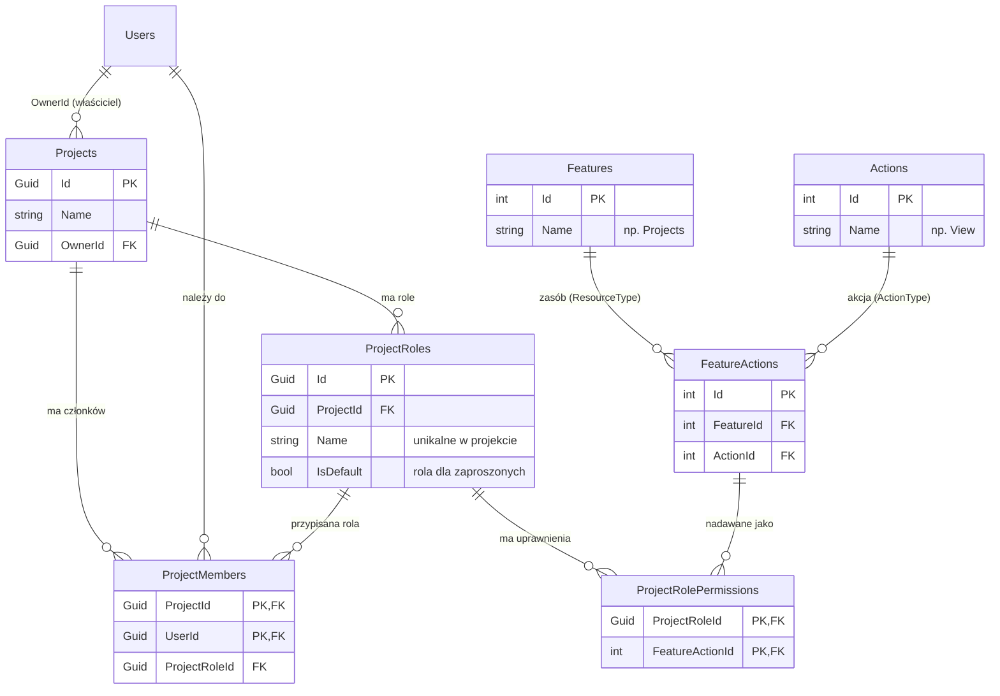

### Co znika, a co zostaje

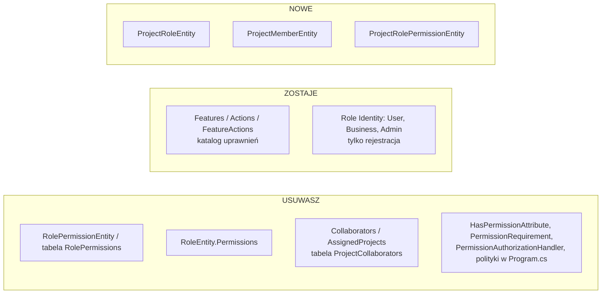

### Konfiguracja EF

| Relacja / klucz | Ustawienie |
|---|---|
| `ProjectMembers` PK | `(ProjectId, UserId)` |
| `ProjectRolePermissions` PK | `(ProjectRoleId, FeatureActionId)` |
| `ProjectRoles` | unikalny indeks `(ProjectId, Name)` |
| `FeatureActions` | unikalny indeks `(FeatureId, ActionId)` |
| Project → ProjectRoles | Cascade |
| Project → ProjectMembers | Cascade |
| ProjectRole → ProjectRolePermissions | Cascade |
| ProjectRole → ProjectMembers | **NoAction** (rola z członkami nie może być usunięta) |
| FeatureAction → ProjectRolePermissions | Cascade |

### Reguły domenowe

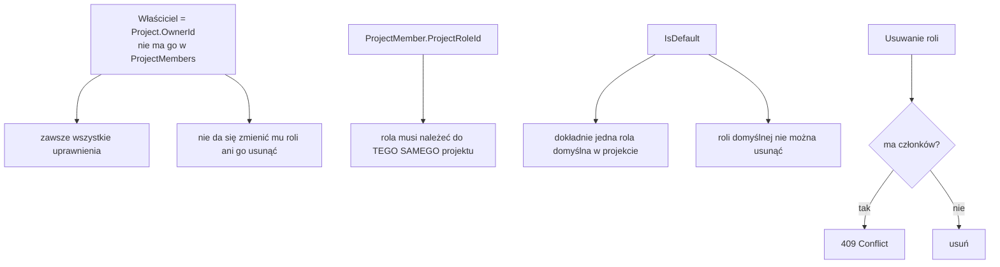

---

## 2. Gdzie sprawdzać uprawnienia

Sprawdzanie jest w **handlerach**, nie w politykach ASP.NET. Wiele endpointów nie ma `projectId` w trasie, tylko `sprintId`, `taskId`, `repositoryId` albo pole w body. Handler i tak ładuje encję, więc zna jej `ProjectId`.

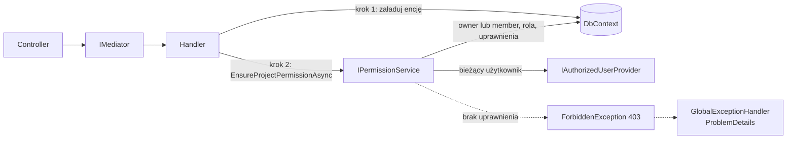

### Przykład: edycja sprintu

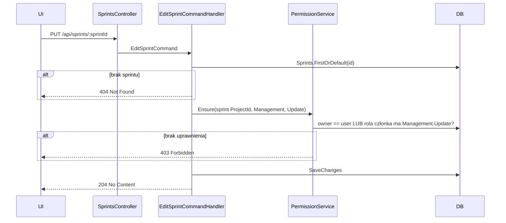

### Logika `EnsureProjectPermissionAsync`

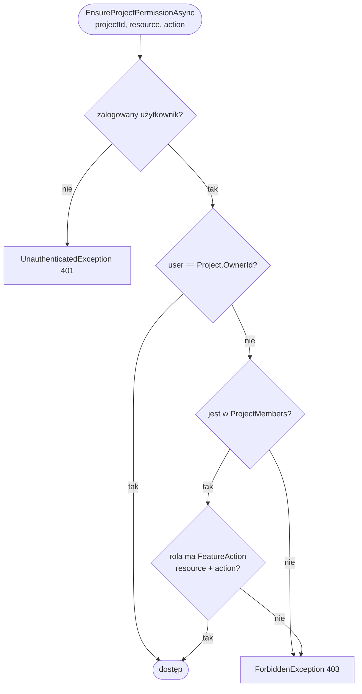

Całość to jedno zapytanie:

```csharp
_context.Projects
    .Where(p => p.Id == projectId)
    .Select(p => p.OwnerId == userId
        || p.Members.Any(m => m.UserId == userId
            && m.ProjectRole.Permissions.Any(rp =>
                   rp.FeatureAction.Feature.Name == resourceName
                && rp.FeatureAction.Action.Name == actionName)))
    .FirstOrDefaultAsync(ct);
```

Nowe wyjątki w `Domain.Exceptions/Auth`, dziedziczące po `ExceptionBase`:
- `ForbiddenException` (403)
- `UnauthenticatedException` (401)

Cache uprawnień nie jest potrzebny. To jedno zapytanie po indeksach, więc nie trzeba go unieważniać.

---

## 3. Mapa uprawnień dla istniejących handlerów

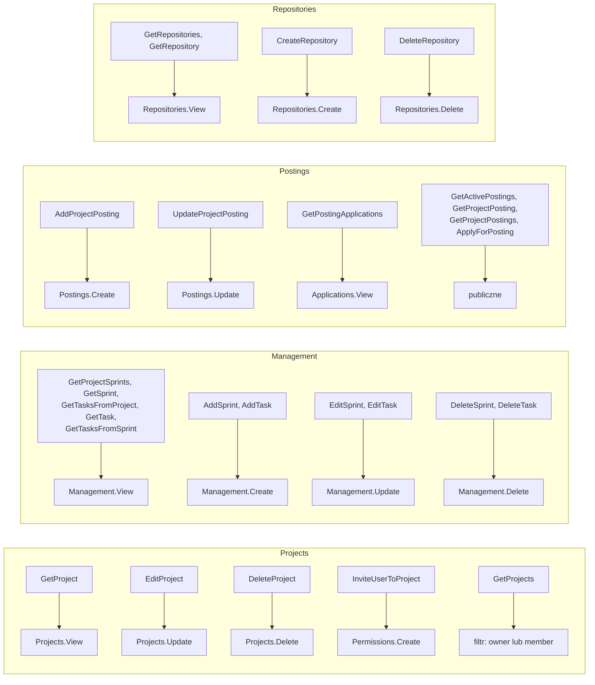

| Handler | Skąd `projectId` | Wymagane |
|---|---|---|
| GetProject | request | Projects.View |
| EditProject | **route** (patrz uwaga niżej) | Projects.Update |
| DeleteProject | request | Projects.Delete |
| InviteUserToProject | request | Permissions.Create |
| GetProjects | – | filtr: owner lub member |
| GetProjectSprints / GetTasksFromProject | request | Management.View |
| GetSprint / GetTask / GetTasksFromSprint | encja | Management.View |
| AddSprint / AddTask | body | Management.Create |
| EditSprint / EditTask | encja | Management.Update |
| DeleteSprint / DeleteTask | encja | Management.Delete |
| AddProjectPosting | body | Postings.Create |
| UpdateProjectPosting | encja | Postings.Update |
| GetPostingApplications | encja posting | Applications.View |
| GetActivePostings / GetProjectPosting(s) / ApplyForPosting | – | publiczne |
| GetRepositories | request | Repositories.View |
| GetRepository | encja | Repositories.View |
| CreateRepository | body | Repositories.Create |
| DeleteRepository | encja | Repositories.Delete |

> **Błąd do poprawienia:** `POST /api/projects/{projectId}/edit` bierze `ProjectId` z body, a nie z trasy. Można wtedy podać w body inny projekt niż w adresie. Bierz id z trasy.

> **Handlery strumieniowe** (`IStreamRequestHandler`) pisz jako `async IAsyncEnumerable<T>` z `[EnumeratorCancellation]`: najpierw `await Ensure…`, potem `await foreach … yield return`.

---

## 4. API ról i członków (feature `Permissions`)

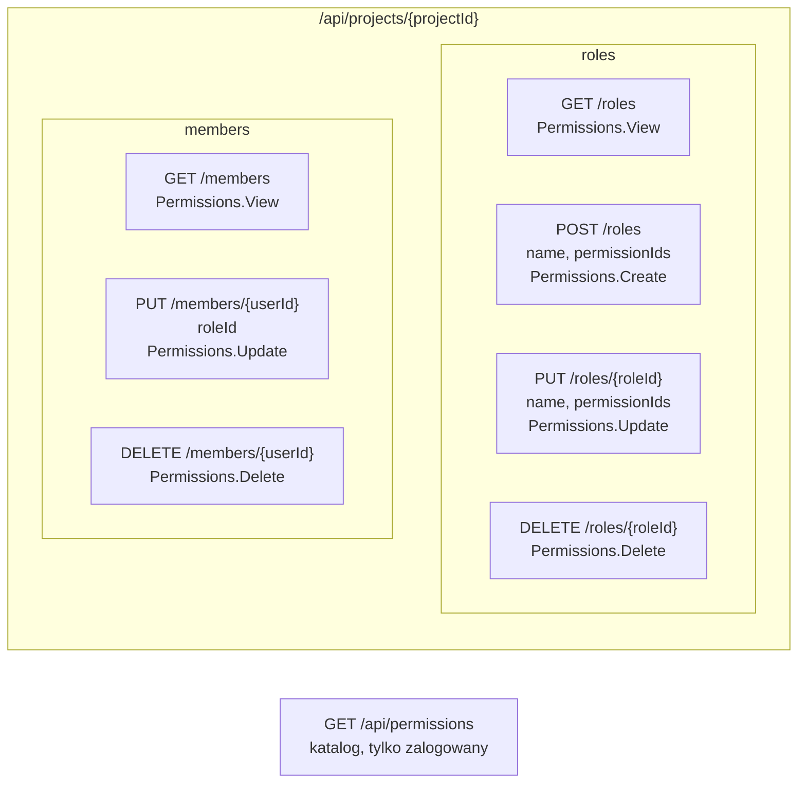

`PUT roles` **zastępuje cały zestaw** uprawnień roli. Frontend wysyła listę zaznaczonych pól z macierzy i na tym polega dynamiczne ustawianie uprawnień.

### DTO

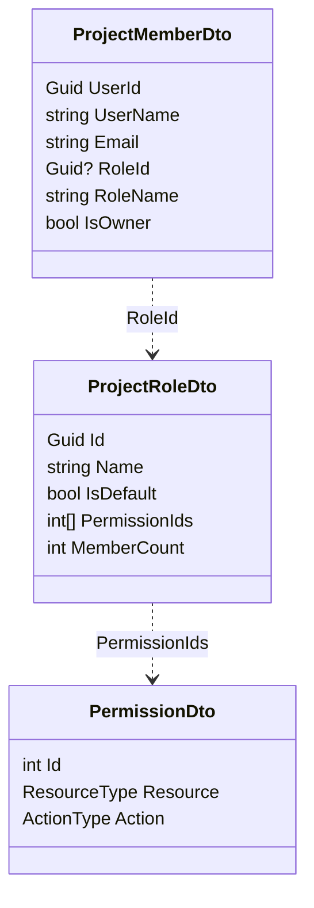

Właściciel jest pierwszym wierszem listy członków, z `IsOwner = true` i `RoleId = null`.

**Do usunięcia z obecnego feature'a:** Create/Update/DeletePermission, Assign/RevokePermissionFromRole, GetRolePermissions, GetUserPermissions, GetRoles, `RoleDto`, `UserPermissionsDto`.

---

## 5. Cykl życia

### Tworzenie projektu

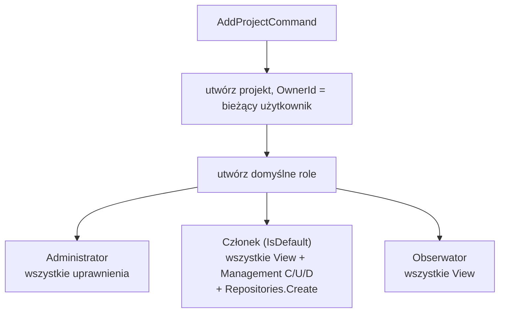

### Zaproszenie użytkownika

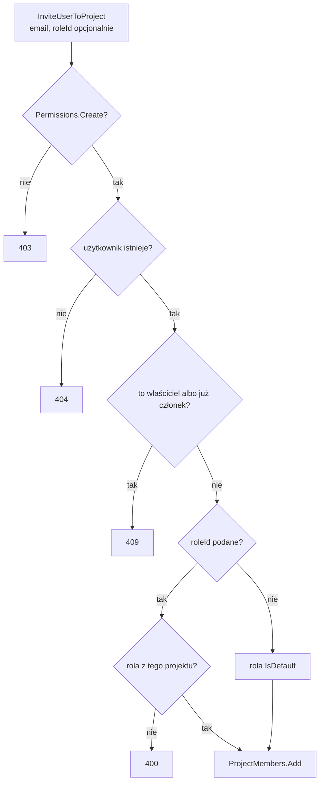

### Katalog uprawnień (seeder przy starcie)

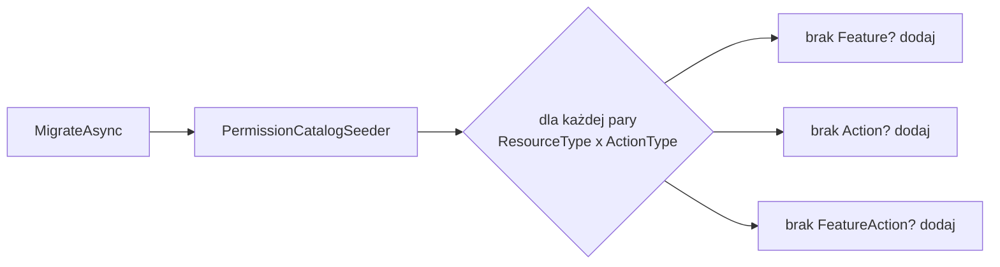

Seeder musi być idempotentny, żeby kolejne uruchomienia niczego nie dublowały. CRUD katalogu przestaje być potrzebny.

### `ProjectAggregate`

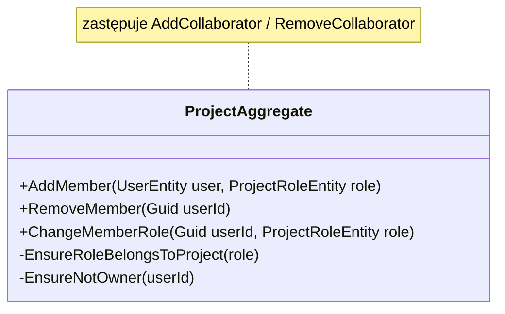

W `GetDiscoverProjects` warunek `Collaborators.All(...)` zamieniasz na `Members.All(m => m.UserId != userId)`.

---

## 6. Migracja

```bash
dotnet ef migrations add ProjectScopedPermissions \
  -p src/Infrastructure/ProjectCowork.Infrastructure.Persistence \
  -s src/Web/ProjectCowork.Api
```

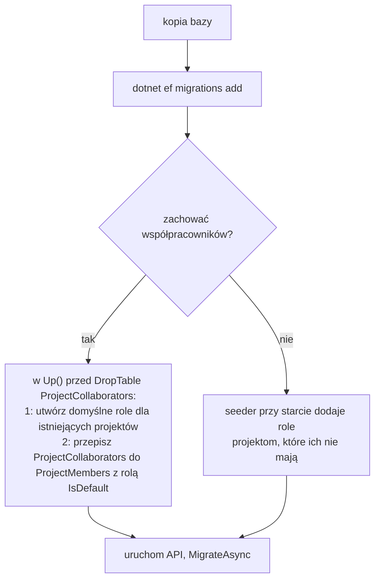

> **Uwaga:** migracja usuwa tabelę `ProjectCollaborators` razem z danymi. `Program.cs` wywołuje `MigrateAsync()`, więc bez wygenerowanej migracji EF zgłosi niezgodność modelu (pending model changes) i aplikacja nie wstanie.

---

## 7. Frontend

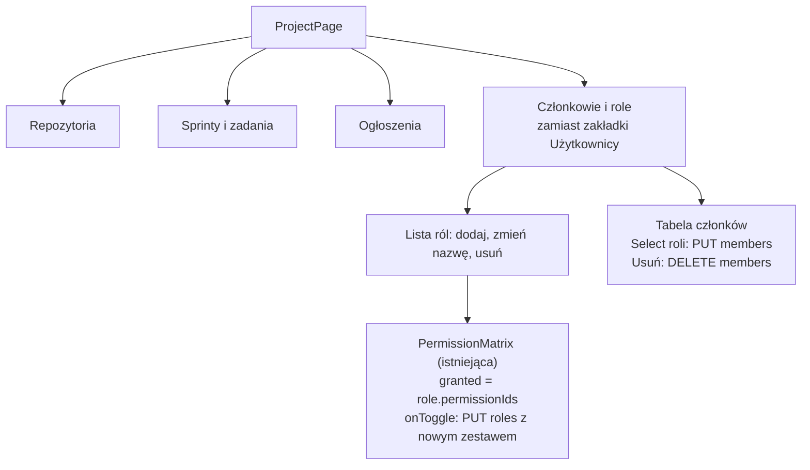

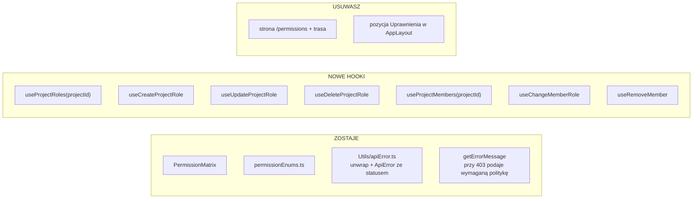

- Każdy hook unieważnia klucz zapytania zawierający `projectId`.
- Gdy API zwróci 403 przy innych akcjach (sprinty, zadania itd.), wystarczy, że ich hooki też przejdą na `unwrap`. Wtedy komunikat „Brak uprawnień” pokaże się sam.
- Po przebudowaniu backendu i wygenerowaniu klienta (`npm run dev` / `build`) możesz w hookach użyć wygenerowanych funkcji zamiast `client.get`.

---

## 8. Kolejność pracy

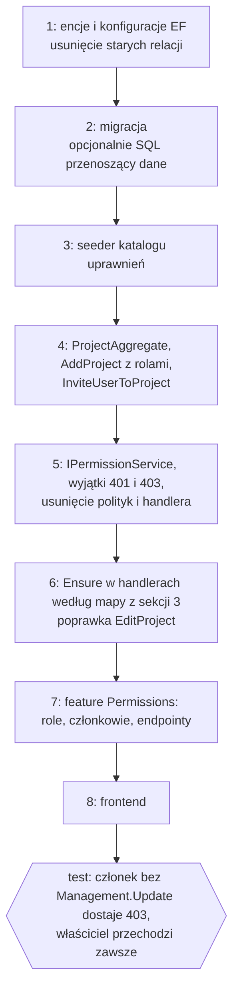
